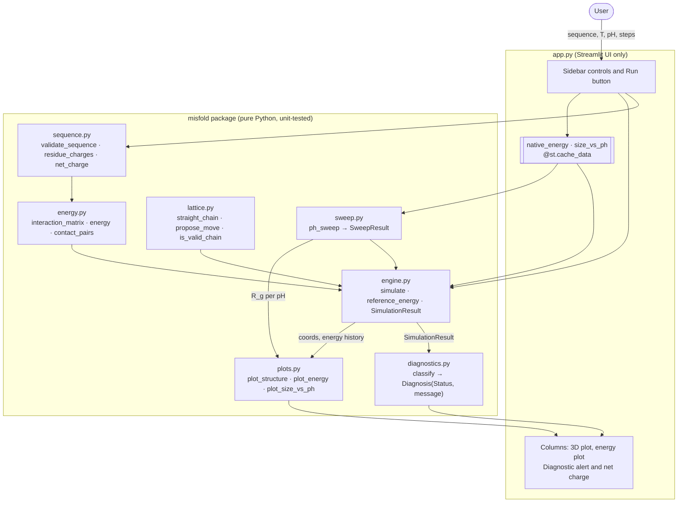
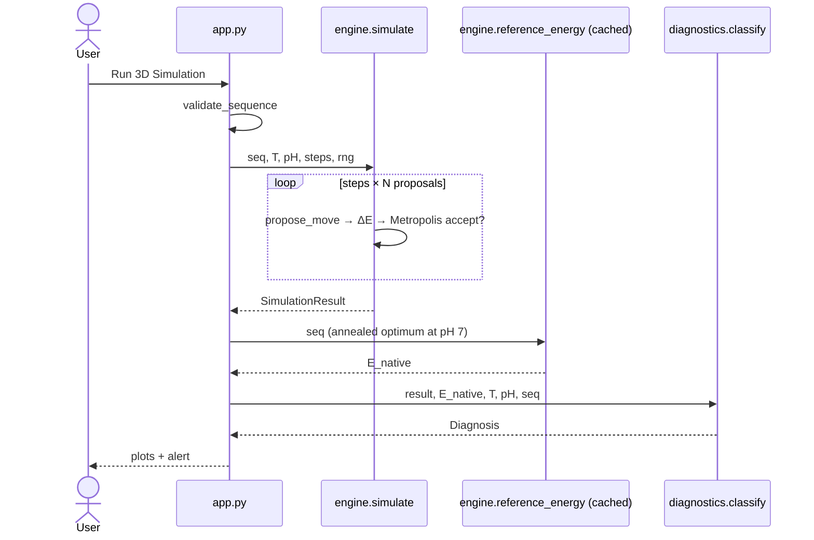

# 3D Protein Misfolding Simulator

Interactive Streamlit app that folds a toy protein on a 3D cubic lattice with
Metropolis Monte Carlo, under a temperature and a pH you choose. It shows the final
3D conformation, the energy trace, and a diagnosis worked out from the simulation
data: **Stable Native Fold**, **Severely Misfolded (Kinetic Trap)** or **Denatured**.

Spec: [`docs/specs/protein_misfolding_spec.md`](docs/specs/protein_misfolding_spec.md) ·
Implementation plan: [`docs/superpowers/plans/2026-10-20-protein-misfolding-simulator.md`](docs/superpowers/plans/2026-10-20-protein-misfolding-simulator.md)

---

## 1. Running the application

**Requirements:** Python ≥ 3.10.

```bash
git clone <repo-url> misfold && cd misfold
python3 -m venv .venv
.venv/bin/pip install -e ".[dev]"      # streamlit, numpy, matplotlib, pytest
.venv/bin/streamlit run app.py         # opens http://localhost:8501
```

Useful variants:

```bash
.venv/bin/streamlit run app.py --server.port 8600             # another port
.venv/bin/streamlit run app.py --server.headless true         # no browser (server / CI)
.venv/bin/pytest -q                                           # full test suite (~20 s)
```

Stop the server with `Ctrl+C`.

---

## 2. Using the application

### Sidebar controls

| Control | Range (default) | Meaning |
|---|---|---|
| **Amino Acid Sequence** | 3–20 letters from `H P K D` (`HKHPHDHPKHHDH`) | `H` hydrophobic, `P` polar, `K` basic (lysine-like), `D` acidic (aspartate-like). Case and spaces are ignored. |
| **Simulation Temperature (T)** | 0.1–5.0, step 0.1 (1.2) | Thermal energy, in reduced units (see §4.3). |
| **Solution pH** | 0.0–14.0, step 0.5 (7.0) | Sets the charge on `K` and `D` residues. |
| **Simulation Steps** | 50–1000, step 50 (300) | Number of Monte Carlo sweeps (one move attempt per residue each). |
| **Run 3D Simulation** | button | Runs one simulation with the current settings. |

An invalid sequence (wrong letters, fewer than 3 or more than 20 residues) shows a red
message in the sidebar and nothing runs.

### Output

The page has two tabs.

#### Simulation tab

- **3D Backbone Conformation** (left): the chain is drawn in the style of VMD's
  NewCartoon (as on the [UIUC protein-folding pages](https://www.ks.uiuc.edu/Research/folding/)):
  a shaded tube coloured red → white → blue from the N-terminus to the C-terminus,
  with `N`/`C` labels at the ends. Beads on the tube show the residue type (H red,
  P blue, K purple, D orange). Beads sit exactly on their lattice sites; the tube
  follows a smooth Catmull-Rom curve through them (`smooth_backbone`, `tube_mesh` in
  `misfold/plots.py`). This only affects the drawing, not the physics. There are no
  helix or sheet shapes because a lattice model has no secondary structure.
- **Thermodynamic Energy Landscape** (right): energy after each sweep. A falling
  curve that levels off means the chain settled into a fold.
- **Diagnostic Evaluation** (bottom), plus the protein's net charge at the chosen pH:

| Alert (Material icon) | Status | Typical cause |
|---|---|---|
| green, `check_circle` | Stable Native Fold | Reached within 80 % of the best possible energy |
| red, `error` | Severely Misfolded (Kinetic Trap) | Too cold to climb out of a wrong fold |
| yellow, `warning` | Denatured | Too hot, or extreme pH broke the salt bridges |
| blue, `info` | No stable fold possible | The sequence has no stabilising contacts at all (e.g. `PPPPP`) |

#### pH vs Size tab

Press **Run pH Sweep** to plot particle size against pH (0–14 in steps of 1) for the
sidebar sequence, temperature and step count. Size is the radius of gyration

$$R_g = \sqrt{\frac{1}{n}\sum_{i=1}^{n} \lVert \mathbf{r}_i - \bar{\mathbf{r}} \rVert^2}$$

of the final conformation, averaged over 6 independent runs per pH (`ph_sweep` in
`misfold/sweep.py`). The shaded band is ±1 standard deviation; the dotted line marks
the sidebar pH. The sweep uses a fixed seed and is cached, so the same settings
redraw the same curve. It runs 90 simulations, so it takes a few seconds (longer at
1000 steps).

A charged sequence such as `KDKDHHKDKDHHKD` gives a U-shape: compact
($R_g \approx 1.2$) between pH 5 and 10 where the salt bridges hold, swelling to
$R_g \approx 1.6$ below pKa 3.9 (D neutralised) and above pKa 10.5 (K neutralised).
An H-rich sequence stays flat because its core does not depend on charge.

Simulation results stay on screen when you run a sweep, and vice versa.

**Look and feel:** dark theme (`.streamlit/config.toml`), with plots styled to match
(`BACKGROUND` / `FOREGROUND` in `misfold/plots.py`). The app icon (browser tab, sidebar
logo, next to the title) is an original render of a chain that is half folded into a
helix and half unravelled, drawn in the same tube style as the 3D plot. Regenerate it
with `.venv/bin/python scripts/make_icon.py` (writes `assets/icon.png`). The other
icons are Google Material Symbols, the icon set used by Material UI, rendered by
Streamlit's built-in `:material/<name>:` syntax.

### Things to try

| Experiment | Settings | Expected |
|---|---|---|
| Normal folding | defaults | mostly Native |
| Cold trap | T = 0.2 | mostly Kinetic Trap |
| Heat denaturation | T = 4.5 | Denatured |
| Acid denaturation | sequence `KDKDHHKDKDHHKD`, pH 2.0 | Denatured (folds at pH 7) |
| Base denaturation | same sequence, pH 12.5 | Denatured (K loses its charge) |
| No core | `PPPPP` | info message |
| Size vs pH | `KDKDHHKDKDHHKD`, pH vs Size tab | U-shaped curve, swelling at both pH extremes |

Runs are random: the same settings can give different outcomes. Run a few times to
see the trend.

---

## 3. Architecture



**Design rules**

- `misfold/` never imports Streamlit, so all of its physics is unit-tested in `tests/`.
  `app.py` only wires widgets to the package.
- Randomness is always passed in as a `numpy.random.Generator`, so tests use fixed
  seeds and are deterministic.
- pH enters in one place only: the residue charges that build the interaction matrix,
  once per run.
- The plots build `matplotlib.figure.Figure` objects directly (no `pyplot` global
  state), so repeated runs don't leak figures.

### One simulation run



---

## 4. The model

### 4.1 Residue charges (Henderson–Hasselbalch)

$$
q_D(\mathrm{pH}) = -\frac{1}{1 + 10^{\,\mathrm{p}K_a^{D} - \mathrm{pH}}},
\qquad
q_K(\mathrm{pH}) = +\frac{1}{1 + 10^{\,\mathrm{pH} - \mathrm{p}K_a^{K}}},
\qquad
q_H = q_P = 0
$$

with $\mathrm{p}K_a^{D} = 3.9$ and $\mathrm{p}K_a^{K} = 10.5$. At pH 7 both are fully
charged. At low pH, $q_D \to 0$; at high pH, $q_K \to 0$.

### 4.2 Energy function

For a conformation $\{\mathbf{r}_i\}$ on the integer lattice, sum over non-bonded pairs
that are lattice neighbours:

$$
E = \sum_{i} \sum_{j > i+1} \varepsilon_{ij}\,\delta(\mathbf{r}_i, \mathbf{r}_j),
\qquad
\delta(\mathbf{r}_i, \mathbf{r}_j) =
\begin{cases}
1 & \text{if } \lVert \mathbf{r}_i - \mathbf{r}_j \rVert_1 = 1 \\
0 & \text{otherwise}
\end{cases}
$$

$$
\varepsilon_{ij} =
\begin{cases}
-1.0 & s_i = s_j = H \quad \text{(hydrophobic contact)} \\
k\,q_i\,q_j, \; k = 0.5 & s_i, s_j \in \{K, D\} \quad \text{(salt bridge / repulsion)} \\
+0.1 & \text{otherwise}
\end{cases}
$$

So a K–D contact at pH 7 is worth $-0.5$, and a K–K contact at pH 2 costs $+0.5$.

### 4.3 Metropolis–Hastings acceptance

Each proposal changes the energy by $\Delta E = E_{\text{proposed}} - E_{\text{current}}$
and is accepted with probability

$$
P(\text{accept}) =
\begin{cases}
1 & \Delta E < 0 \\[4pt]
\exp\!\left(-\dfrac{\Delta E}{T / \tau}\right) & \Delta E \ge 0
\end{cases}
\qquad \tau = 6
$$

The slider temperature $T$ is in **reduced units**: $\tau$ = `TEMPERATURE_SCALE` puts
the folding transition where the spec places it (trap for $T \lesssim 0.5$, fold near
$T \approx 1.2$, denature for $T \gtrsim 3$). With the literal $e^{-\Delta E/T}$, this
energy scale only folds below $T \approx 0.3$.

### 4.4 Moves

Each step is one **sweep**: $N$ proposals for a chain of $N$ residues. Each proposal
picks a residue at random and applies one legal, self-avoiding local move:

- **End move:** a terminal bead jumps to any free neighbour of its bonded bead.
- **Corner flip:** at an L-shaped corner $(\mathbf{r}_{i-1}, \mathbf{r}_i, \mathbf{r}_{i+1})$,
  move $\mathbf{r}_i \to \mathbf{r}_{i-1} + \mathbf{r}_{i+1} - \mathbf{r}_i$.
- **Crankshaft:** a U-shaped pair $(i, i+1)$ rotates 90° or 180° about the axis
  $\mathbf{r}_{i-1} \to \mathbf{r}_{i+2}$.

The chain starts fully extended along $x$.

### 4.5 Diagnosis

Every run is compared with $E_{\text{native}}$, the lowest energy found by simulated
annealing at **pH 7** (1500 sweeps, $T_{\text{eff}}$ from 2.0 down to 0.1 geometrically,
seed 0, cached per sequence). The uphill acceptance is

$$
a_{\uparrow} = \frac{\#\{\text{accepted moves with } \Delta E > 0\}}{\#\{\text{proposed moves with } \Delta E > 0\}}
$$

Rules, applied in order:

1. $E_{\text{native}} \ge 0$ → *No stable fold possible* (info).
2. $E_{\text{final}} \le 0.8\,E_{\text{native}}$ → **Stable Native Fold**.
3. $a_{\uparrow} \ge 0.25$ → **Denatured**. The cause is given as acid if
   $\mathrm{pH} \le 4$ and the sequence contains D, base if $\mathrm{pH} \ge 10$ and it
   contains K, otherwise heat.
4. Otherwise → **Severely Misfolded (Kinetic Trap)**.

The reference is fixed at pH 7 on purpose: a lattice chain can always avoid repulsive
contacts by spreading out, so pH shows up as lost stabilisation compared with the
native-condition optimum.

### 4.6 Limits

- Sequences are capped at **20 residues**. Beyond that, these local moves (which
  cannot reach every conformation of a long chain) don't reach the native fold within
  1000 sweeps, so every run would read as a trap.
- pH acts only through contacts. Sequences rich in `H` and poor in `K`/`D` (such as the
  spec's original `HHPHPHPHPHHPH`) barely respond to pH, and that particular one
  usually ends in a kinetic trap at the default settings.

---

## 5. Updating the application

### Pull a new version

```bash
git pull
.venv/bin/pip install -e ".[dev]"      # picks up any dependency changes
.venv/bin/pytest -q                    # confirm everything is green
.venv/bin/streamlit run app.py
```

Upgrade the libraries in an existing environment with
`.venv/bin/pip install -U -e ".[dev]"`, then run the tests again.

### Change the model

Every tunable value is a named module constant:

| What | File | Constant(s) |
|---|---|---|
| Sequence length limits, pKa values | `misfold/sequence.py` | `MIN_LENGTH`, `MAX_LENGTH`, `PKA_ACID`, `PKA_BASE` |
| Contact energies | `misfold/energy.py` | `HH_EPSILON`, `OTHER_EPSILON`, `COULOMB_K` |
| Temperature unit, annealing | `misfold/engine.py` | `TEMPERATURE_SCALE`, `ANNEAL_T_START`, `ANNEAL_T_END`, `REFERENCE_SWEEPS` |
| Diagnosis thresholds | `misfold/diagnostics.py` | `NATIVE_FRACTION`, `DENATURED_UPHILL`, `PH_DENATURATION_OFFSET` |
| Colours, labels, plot theme | `misfold/plots.py` | `RESIDUE_COLORS`, `RESIDUE_LABELS`, `BACKBONE_CMAP`, `TUBE_RADIUS`, `ENERGY_COLOR`, `BACKGROUND`, `FOREGROUND` |
| App theme | `.streamlit/config.toml` | `[theme]` (`base = "dark"`) |
| App icon | `scripts/make_icon.py` → `assets/icon.png` | `misfold_path`, `render` |
| Other icons | `app.py` | `:material/<name>:` strings, `ALERTS` |
| Slider ranges, defaults, text | `app.py` | widget arguments |

After changing any physics constant, run

```bash
.venv/bin/pytest tests/test_diagnostics.py -q
```

`test_calibration` runs real simulations (10 seeds per case) and checks that the
documented behaviour still holds: cold traps, default folds, hot denatures, acid
denatures, and a 20-residue chain still folds. If it fails, retune the
diagnosis thresholds rather than loosening the test.

### Add a residue type

1. Add the letter to `ALPHABET` (and a charge rule, if charged) in `misfold/sequence.py`.
2. Give it interactions in `interaction_matrix` in `misfold/energy.py`.
3. Add a colour and label in `misfold/plots.py`.
4. Update the input label in `app.py`, then add tests for each step.

### Project layout

```
app.py                  Streamlit UI
assets/icon.png         app icon (generated by scripts/make_icon.py)
scripts/make_icon.py    icon renderer
misfold/                simulation package (no Streamlit imports)
tests/                  pytest suite, one file per module + AppTest UI tests
docs/specs/             original specification
docs/superpowers/plans/ implementation plan
```

---

## 6. Differences from the spec's reference code

1. The reference move (a random ±1 jump that must keep both bonds at length 1) can
   never move a bead of a straight chain, so its chain never changes. It is replaced by
   the lattice moves in §4.4.
2. Self-avoidance is enforced.
3. The diagnosis is computed from simulation data instead of the temperature slider.
4. Temperature is in reduced units (§4.3).
5. pH and the `K`/`D` residues are an extension. The default sequence is
   `HKHPHDHPKHHDH` so pH has a visible effect.
6. Sequence length is capped at 20 (§4.6).
